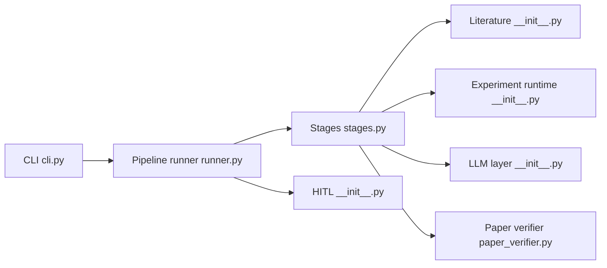

# aiming-lab/AutoResearchClaw

> Agent pipeline that turns a research topic into a LaTeX paper with executed experiments.

## The problem
Literature review, experiment design, execution, analysis and writing take weeks, with a risk of invented references.

## What it actually does
23-stage pipeline: scoping, collection from OpenAlex/Semantic Scholar/arXiv, hypotheses through multi-agent debate, code generation.
Experiments in a local sandbox, Docker or SSH, GPU detection, automatic repair; PROCEED/REFINE/PIVOT decision.
Writing in NeurIPS/ICLR/ICML templates, 4-level citation verification, anti-fabrication guard.
Human-in-the-loop modes (co-pilot, gate-only...), cost budgets; LLM through an OpenAI-compatible API or an ACP agent (Claude Code, Codex...).

## How it is wired


## Trying it
```bash
git clone https://github.com/aiming-lab/AutoResearchClaw.git
cd AutoResearchClaw
pip install -e .
researchclaw setup
researchclaw init
researchclaw run --config config.arc.yaml --topic "Your research idea" --auto-approve
```

## Cost and gotchas
LLM calls are billed (configurable budget); Docker and LaTeX are checked by `setup`. A GPU is useful for the experiments.

## What it is not
Not a guarantee of scientific validity: the papers still need review. Very young repo (March 2026).

## Alternatives
- AI Scientist (Sakana AI): pioneer, cited as an inspiration.
- AutoResearch (Andrej Karpathy): end-to-end automation, also cited.

## For you
Worth watching: the idea of tooling up literature review and baselines is useful, but the "one topic, one paper" approach demands tight human control.
