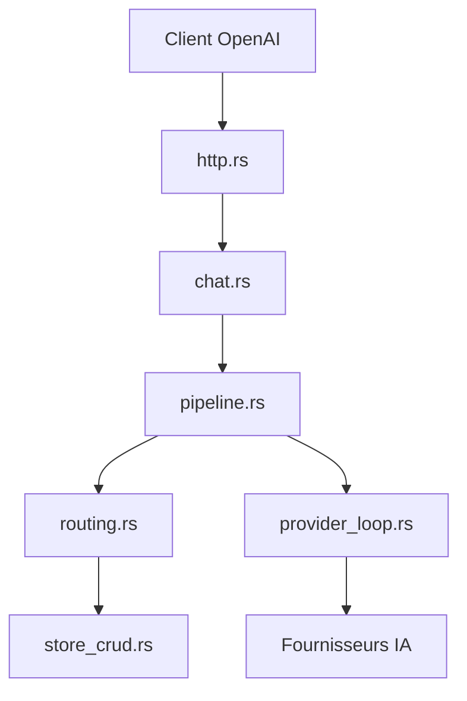

# aimod-cc/Agent2API

> Local gateway that unifies several model providers behind an OpenAI and Anthropic API, with routing.

## The problem
Using several accounts and model providers forces you to reconfigure each agent client by hand.

## What it actually does
A Tauri (Rust) application exposes a local HTTP server on port 3065. It translates OpenAI Chat, Responses, Images and Anthropic Messages calls, resolves the model, picks an account by priority with load balancing and failover, then relays to the provider. It manages gateway keys, usage reports, outbound proxies and profiles for local agent clients.

## How it is wired


## Trying it
```bash
docker run -d --name agent2api --restart unless-stopped -p 3065:3065 -v ./data:/data aimodcc/agent2api:latest
curl http://127.0.0.1:3065/health
```

## Cost and gotchas
Accounts and calls to the providers remain at your expense. Credentials are encrypted in the local database but exports and backups may contain them. AGPL-3.0 license. Additional capabilities come through separately installed plugins.

## What it is not
Not a model provider: it hosts none. The README does not detail the terms of use of the upstream services; they remain to be verified.

## Alternatives
No alternative named in the README.

## For you
Worth watching: handy for centralizing keys and multi-provider routing, but the AGPL license and the young repository (September 2026, 193 open issues) call for caution.
