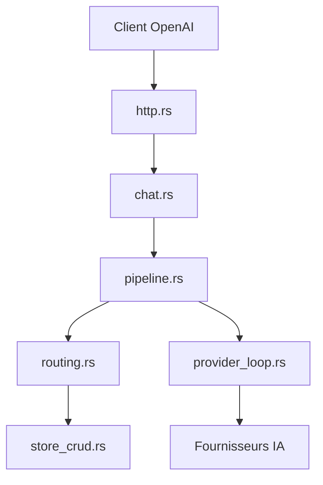

# aimod-cc/Agent2API

> Passerelle locale qui unifie plusieurs fournisseurs de modèles en une API OpenAI et Anthropic, avec routage.

## Le problème
Utiliser plusieurs comptes et fournisseurs de modèles oblige à reconfigurer chaque client d'agent à la main.

## Ce que ça fait vraiment
Une application Tauri (Rust) expose un serveur HTTP local sur le port 3065. Il traduit les appels OpenAI Chat, Responses, Images et Anthropic Messages, résout le modèle, choisit un compte par priorité avec équilibrage et bascule, puis relaie vers le fournisseur. Elle gère les clés de passerelle, rapports d'usage, proxys de sortie et profils de clients d'agents locaux.

## Comment c'est branché


## Essayer
```bash
docker run -d --name agent2api --restart unless-stopped -p 3065:3065 -v ./data:/data aimodcc/agent2api:latest
curl http://127.0.0.1:3065/health
```

## Coût et pièges
Les comptes et appels aux fournisseurs restent à ta charge. Les identifiants sont chiffrés dans la base locale mais les exports et sauvegardes peuvent les contenir. Licence AGPL-3.0. Les capacités supplémentaires passent par des plugins installés à part.

## Ce que ce n'est pas
Ce n'est pas un fournisseur de modèles : il n'en héberge aucun. Le README ne détaille pas les conditions d'usage des services en amont ; elles restent à vérifier.

## Alternatives
Aucune alternative nommée dans le README.

## Pour toi
À surveiller : pratique pour centraliser clés et routage multi-fournisseurs, mais la licence AGPL et le dépôt jeune (septembre 2026, 193 issues ouvertes) appellent à la prudence.

