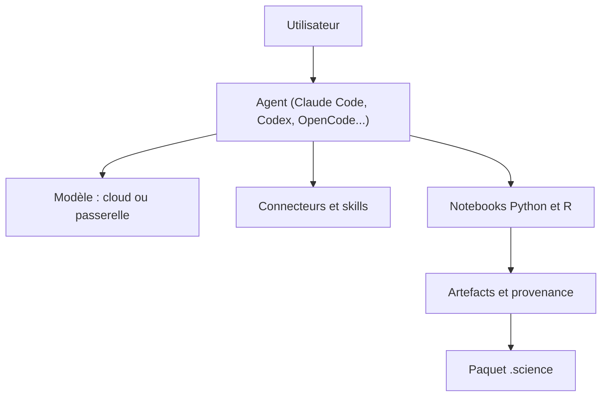

# aipoch/open-science

> Local AI research workbench to analyze papers and data with an agent, in a reproducible way.

## The problem
A result produced with an agent is hard to replay and share: code, inputs and history get scattered.

## What it actually does
Desktop app, web interface or CLI: you describe a question, the agent reads papers, runs Python or R in notebooks and produces versioned artifacts with their provenance. It includes 24 built-in skills, 48 scientific connectors, 10 specialists, a reference library and an automatic reviewer. A `.science` package exports the session for review; import is read-only.

## How it is wired
Simplified diagram based on the note, no diagram provided.


## Trying it
```bash
npm install --global @aipoch/open-science
open-science start --no-open
open-science url
brew install --cask open-science
```

## Cost and gotchas
A model provider with its key, at your expense, is required. Node 22.13+ for the npm version. The printed URL contains a token: keep it private. Benchmarks are internal to AIPOCH.

## What it is not
Not proof of scientific validity: replay does not guarantee it. Published scores come from the vendor's own tests, not from an official ranking.

## Alternatives
No alternative named in the README.

## For you
Worth watching: traceability and `.science` export are interesting for reproducible research, but it is young and evaluated by its own authors.
