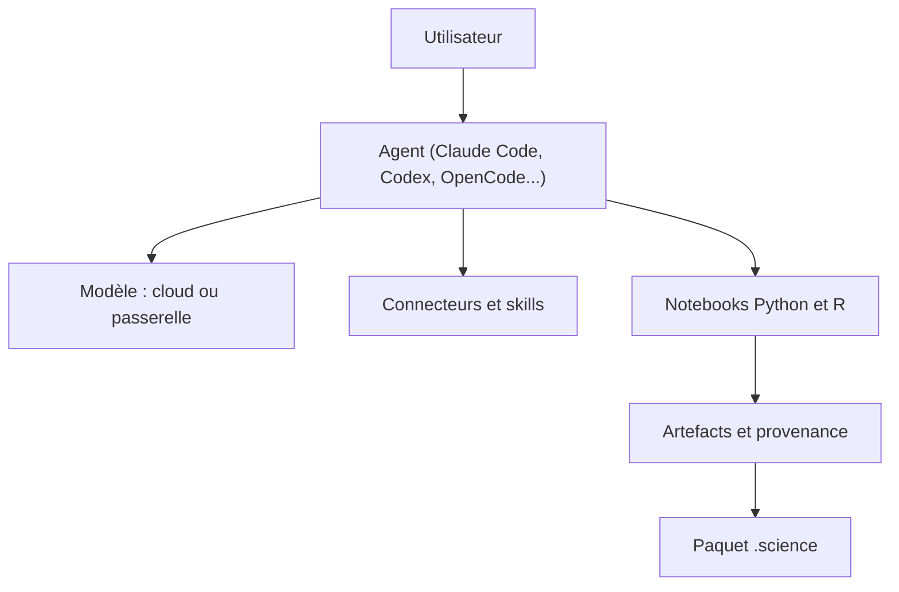

# aipoch/open-science

> Atelier de recherche IA local pour analyser articles et données avec un agent, de façon reproductible.

## Le problème
Un résultat produit avec un agent est difficile à rejouer et à partager : code, entrées et historique se dispersent.

## Ce que ça fait vraiment
Application de bureau, interface web ou CLI : tu décris une question, l'agent lit des articles, exécute du Python ou du R dans des carnets et produit des artefacts versionnés avec leur provenance. Elle compte 24 skills intégrés, 48 connecteurs scientifiques, 10 spécialistes, une bibliothèque de références et un relecteur automatique. Un paquet `.science` exporte la session pour relecture ; l'import est en lecture seule.

## Comment c'est branché
Schéma simplifié d'après la fiche, sans diagramme fourni.


## Essayer
```bash
npm install --global @aipoch/open-science
open-science start --no-open
open-science url
brew install --cask open-science
```

## Coût et pièges
Un fournisseur de modèle avec sa clé, à ta charge, est requis. Node 22.13+ pour la version npm. L'URL imprimée contient un jeton : à garder privée. Les benchmarks sont internes à AIPOCH.

## Ce que ce n'est pas
Pas une preuve de validité scientifique : le replay ne la garantit pas. Les scores publiés viennent des propres essais de l'éditeur, pas d'un classement officiel.

## Alternatives
Aucune alternative nommée dans le README.

## Pour toi
À surveiller : traçabilité et export `.science` intéressants pour la recherche reproductible, mais jeune et évalué par ses auteurs.

