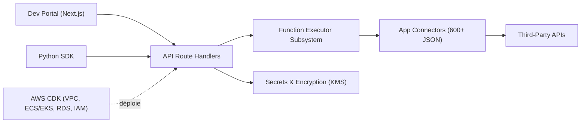

# aipotheosis-labs/aci

> Platform that gives AI agents access to 600+ tools through a unified MCP server or an SDK.

## The problem
Each third-party tool (Google Calendar, Slack...) needs its own OAuth flow and API client. Piling these tools into the LLM context overloads it.

## What it actually does
A FastAPI backend exposes app and function definitions (JSON) as function calls or as an MCP server. It handles multi-tenant authentication, natural-language permissions, dynamic tool discovery and usage logs. A Next.js portal is used to configure projects and the Playground. The Python SDK calls the same endpoints.

## How it is wired


## Trying it
```bash
# Le README renvoie aux README de chaque composant :
#   backend/README.md
#   frontend/README.md
# Aucune commande n'est donnée dans le README racine.
```

## Cost and gotchas
The managed service (aci.dev) is a SaaS; self-hosting requires a backend, a frontend and PostgreSQL, with an AWS CDK deployment described in the code. Each integration requires the OAuth credentials of the third-party service.

## What it is not
This repo is the platform, not the unified MCP server (separate `aci-mcp` repo). It is not an agent framework: it provides the tools, not the reasoning loop.

## Alternatives
- aci-mcp: the unified MCP server itself, if that is all you want.
- aci-python-sdk / aci-typescript-sdk: direct access without the portal.

## For you
Worth watching: useful if your agents must call many SaaS APIs with per-user OAuth, but full self-hosting (AWS, Postgres, KMS) is heavy for a modest need.
