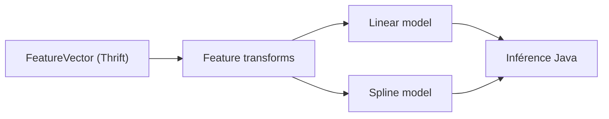

# airbnb/aerosolve

> Machine learning library in Scala and Java producing interpretable models, for sparse data such as search or pricing.

## The problem
Dense models are opaque: you cannot see which variables are faulty or why the model is wrong.

## What it actually does
Examples are described as Thrift feature vectors (context plus items). A feature transform language acts on feature families. Two main models are readable: a linear model (hinge, logistic, ranking) and a spline model. Training is in Scala, inference in lightweight Java.

## How it is wired

Simplified diagram based on the sheet, no diagram provided.

## Trying it
```bash
# Aucune commande dans le README : les artefacts sont sur bintray,
# à ajouter comme dépôt Maven, SBT ou Gradle ; démos d'image et de revenu fournies.
```

## Cost and gotchas
Free. You need a JVM, Scala and Thrift toolchain; the README mentions Spark and Hadoop for compilation under IntelliJ. The cited artifact repository (bintray) is given as the source.

## What it is not
Not suited to dense features such as pixels or audio: the README says so. The maxout and boosted stumps models are experimental or secondary.

## Alternatives
No alternative named in the README.

## For you
Ignore: the interpretable approach is interesting, but the last push is more than a year old and the Scala/Thrift ecosystem is far from current tools.
