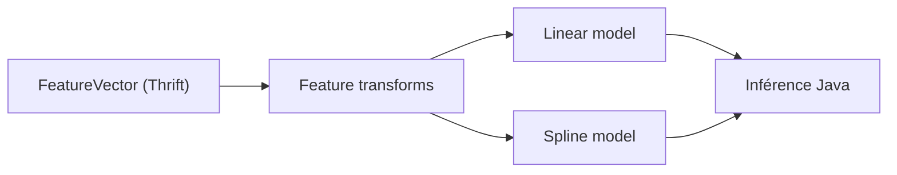

# airbnb/aerosolve

> Bibliothèque d'apprentissage automatique en Scala et Java produisant des modèles interprétables, pour données creuses de type recherche ou prix.

## Le problème
Les modèles denses sont opaques : on ne voit ni quelles variables sont défectueuses ni pourquoi le modèle se trompe.

## Ce que ça fait vraiment
Les exemples sont décrits en vecteurs de traits Thrift (contexte plus items). Un langage de transformation de traits agit sur les familles de traits. Deux modèles principaux sont lisibles : un modèle linéaire (hinge, logistique, ranking) et un modèle à splines. L'entraînement est en Scala, l'inférence en Java léger.

## Comment c'est branché

Schéma simplifié d'après la fiche, sans diagramme fourni.

## Essayer
```bash
# Aucune commande dans le README : les artefacts sont sur bintray,
# à ajouter comme dépôt Maven, SBT ou Gradle ; démos d'image et de revenu fournies.
```

## Coût et pièges
Gratuit. Il faut une chaîne JVM, Scala et Thrift ; le README cite Spark et Hadoop pour la compilation sous IntelliJ. Le dépôt d'artefacts cité (bintray) est donné comme source.

## Ce que ce n'est pas
Pas adapté aux traits denses comme les pixels ou l'audio : le README le dit. Les modèles maxout et boosted stumps sont expérimentaux ou secondaires.

## Alternatives
Aucune alternative nommée dans le README.

## Pour toi
À ignorer : l'approche interprétable est intéressante, mais le dernier push date de plus d'un an et l'écosystème Scala/Thrift est loin des outils actuels.

