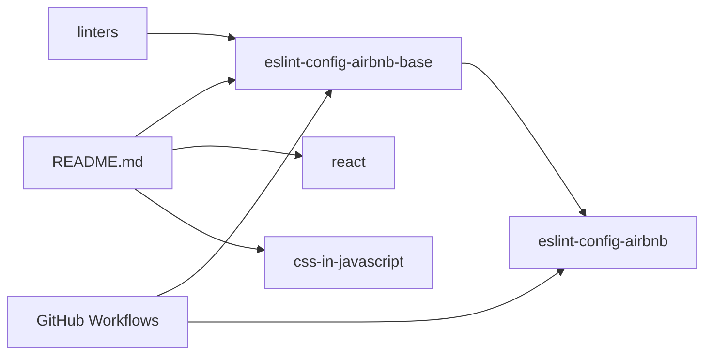

# airbnb/javascript

> Airbnb's JavaScript Style Guide, explained rule by rule, with accompanying ESLint configuration files.

## The problem
Without shared conventions, a JavaScript team wastes time on code reviews focusing on aspects like variable declaration (`var`), scope, and object usage.

## What it actually does
The README lists numbered rules (1.1 primitive types, 2.1 `const` instead of `var`, 3.x objects, etc.), each with a bad/good example, a justification ("Why?"), and the corresponding ESLint rule (`prefer-const`, `no-var`, `object-shorthand`, etc.).
The repository publishes two packages: `eslint-config-airbnb-base` and `eslint-config-airbnb` (which extends it with React), as well as supplementary React and CSS-in-JavaScript guides.
The guide assumes Babel (`babel-preset-airbnb`) and polyfills (`airbnb-browser-shims`).

## How it is wired

## Trying it
No documented commands were found in the read-only section of the README.

## Cost and gotchas
Free, from MIT. The guide assumes the use of Babel and polyfills: a project without them cannot be directly adapted.

## What it is not
Not a code formatter: ESLint rules and configurations only, with no TypeScript support in the code itself. The ES5 version is marked as deprecated.

## Alternatives
There is no alternative named in the README (only the other Airbnb guides: React, CSS & Sass, Ruby).

## For you
Outside your data/AI scope: ignore unless you are writing a lot of JavaScript code.
