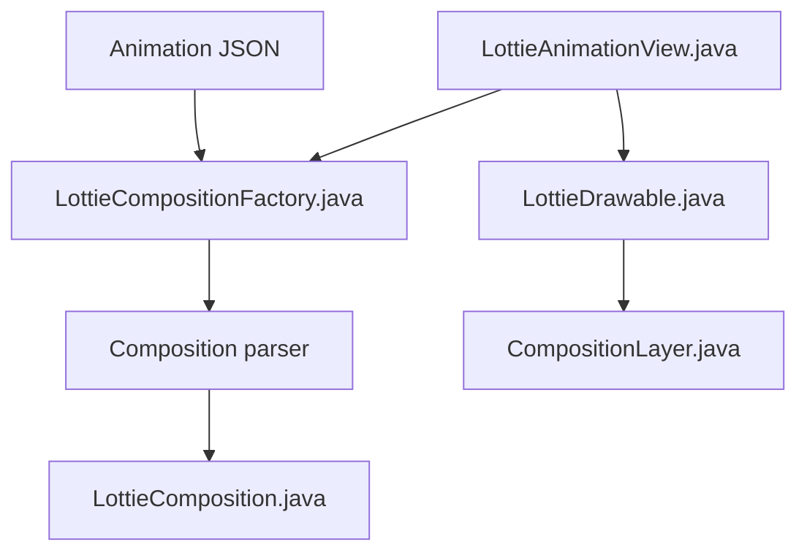

# airbnb/lottie-android

> Android library that reads After Effects animations exported as JSON (Bodymovin) and renders them natively.

## The problem
Animations drawn by a designer have to be recreated by hand by a developer.

## What it actually does
Parses the JSON into a composition (layers, keyframes, shapes) then draws the animation according to its progress. Usable with classic Android views or with Jetpack Compose (LottieAnimation.kt). Loads animations from assets or the network, and also handles images and fonts.

## How it is wired


## Trying it
```bash
# Dépendance Gradle du README
implementation 'com.airbnb.android:lottie:$lottieVersion'
```

## Cost and gotchas
Free. Gradle is the only supported build configuration. The project requires AndroidX since version 2.8.0. Last push in February 2026.

## What it is not
Not an animation editor: it plays exported files. The README provided covers only Android although the title also mentions iOS, React Native, Web and Windows.

## Alternatives
No alternative named in the README.

## For you
Ignore: an Android development tool unrelated to data / AI / MLOps work.
