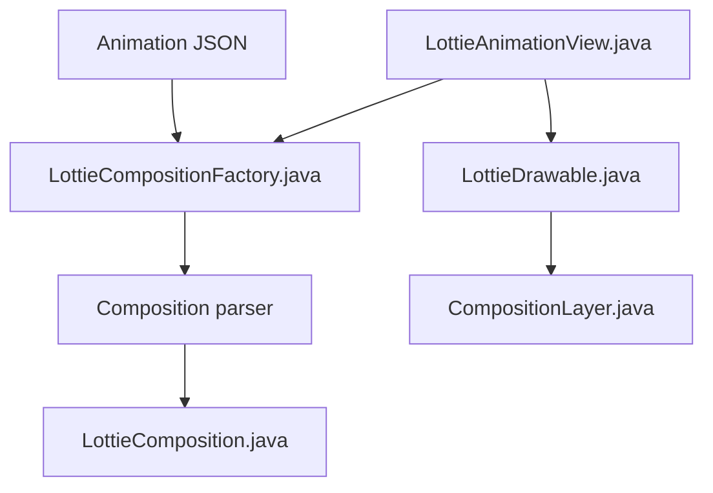

# airbnb/lottie-android

> Bibliothèque Android qui lit des animations After Effects exportées en JSON (Bodymovin) et les affiche en natif.

## Le problème
Les animations dessinées par un designer doivent être recréées à la main par un développeur.

## Ce que ça fait vraiment
Analyse le JSON en une composition (calques, images clés, formes) puis dessine l'animation selon la progression. Utilisable avec les vues Android classiques ou avec Jetpack Compose (LottieAnimation.kt). Charge des animations depuis les assets ou le réseau, gère aussi les images et les polices.

## Comment c'est branché


## Essayer
```bash
# Dépendance Gradle du README
implementation 'com.airbnb.android:lottie:$lottieVersion'
```

## Coût et pièges
Gratuit. Gradle est la seule configuration de build prise en charge. Le projet exige AndroidX depuis la version 2.8.0. Dernier push en février 2026.

## Ce que ce n'est pas
Pas un éditeur d'animations : il joue des fichiers exportés. Le README fourni ne couvre que Android alors que le titre cite aussi iOS, React Native, Web et Windows.

## Alternatives
Aucune alternative nommée dans le README.

## Pour toi
À ignorer : outil de développement Android sans rapport avec un travail data / IA / MLOps.

