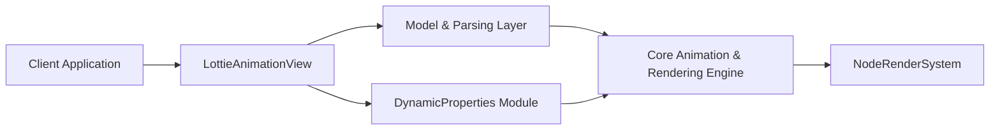

# airbnb/lottie-ios

> Apple library that natively renders JSON vector animations exported from After Effects.

## The problem
Recreating by hand, in code, the animations drawn by designers is slow and drifts from the original design.

## What it actually does
Loads animations in bodymovin JSON format and renders them in real time on iOS, macOS, tvOS and visionOS, relying on Apple's CALayer/CAAnimation layers and a node-based rendering system. Playback, looping, speed, reversal, partial range; properties modifiable at runtime (color, position). An LRU cache and reading of compressed `.lottie` files are included.

## How it is wired


## Trying it
```swift
.package(url: "https://github.com/airbnb/lottie-spm.git", from: "4.6.1")
```
```ruby
pod 'lottie-ios'
```

## Cost and gotchas
Free. The main repository weighs more than 300 MB; the README recommends the `lottie-spm` repository for Swift Package Manager. The README states it collects no data.

## What it is not
It is not an animation authoring tool: it plays exported files. The Android and Web versions are in other repositories.

## Alternatives
- No alternative named in the README.

## For you
Ignore: an Apple mobile UI library, unrelated to data, AI or MLOps.
