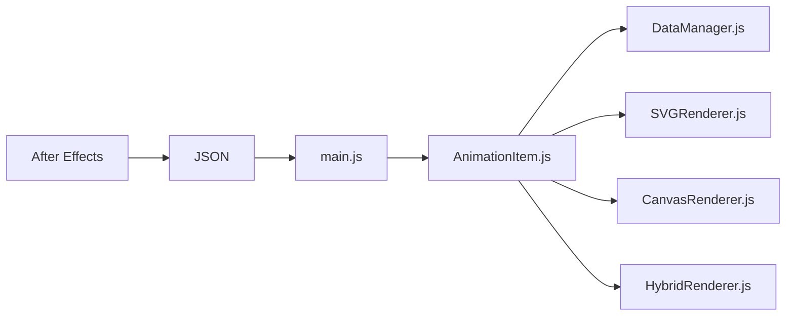

# airbnb/lottie-web

> Web player for After Effects animations exported as JSON, for designers and front-end developers.

## The problem
Getting designers' animations delivered without the developer redoing them by hand.

## What it actually does
A Bodymovin plugin exports an After Effects composition as JSON; the lottie-web player renders it as SVG, canvas or HTML in a page. The API offers play, pause, speed, segments, events, and loading through HTML attributes ("lottie" class). Worker-based processing is optional.

## How it is wired


## Trying it
```bash
npm install lottie-web
```
```js
lottie.loadAnimation({
  container: element,
  renderer: 'svg',
  loop: true,
  autoplay: true,
  path: 'data.json'
});
```

## Cost and gotchas
The export plugin assumes After Effects, paid software that is not provided. Rendering is real-time: too many nodes slows it down. Last push in September 2025.

## What it is not
Not an animation authoring tool. The README also mentions mobile but this repository is the web player.

## Alternatives
No alternative named in the README.

## For you
Watch: useful only for animating a dashboard or a demo; the dependency on After Effects limits its interest outside design.
