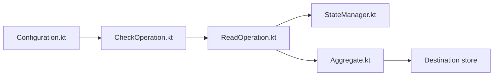

# airbytehq/airbyte

> Open source ELT platform moving data from APIs and databases to warehouses, lakes and AI agents.

## The problem
Writing and maintaining one connector per source and per destination does not scale.

## What it actually does
Provides more than 600 connectors. A sync checks the source, discovers streams, reads records and states, then the destination parses, aggregates in batches and writes. A no-code Connector Builder and a low-code CDK let you create connectors. An Agent SDK (`airbyte-agent-sdk`) exposes connectors as LLM tools.

## How it is wired


## Trying it
```bash
uv pip install airbyte-agent-sdk
```
ELT deployment refers to the documentation (not detailed in the README).

## Cost and gotchas
Open Source to self-host, or paid Airbyte Cloud; Enterprise adds security features. License present but not identified by GitHub.

## What it is not
Not a transformation tool: it moves data. The README does not state the resources required.

## Alternatives
Not documented: the README only cites compatible orchestrators (Airflow, Dagster, Kestra).

## For you
Adopt it to feed a warehouse or an ML pipeline: large connector library; check the license.
