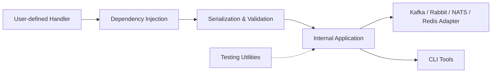

# airtai/faststream

> Asynchronous Python framework for writing Kafka, RabbitMQ, NATS, Redis or MQTT producers and consumers.

## The problem
Every messaging service re-implements serialization, lifecycle, acknowledgements, docs and tests against a real broker by hand.

## What it actually does
FastAPI-style `@broker.subscriber` and `@broker.publisher` decorators, Pydantic or Msgspec validation, dependency injection. Generates an AsyncAPI spec from the code. An in-memory `TestBroker` lets you test without a container. Thin client: the broker's native client remains accessible. No retries or business orchestration provided.

## How it is wired


## Trying it
```bash
pip install 'faststream[kafka]'
pip install "faststream[cli]"
faststream run basic:app
faststream run basic:app --reload
```

## Cost and gotchas
Free; a running broker is required. The FastAPI plugin is deprecated (faststream_fastapi package). Version 1.0 not yet released: breaking changes remain possible.

## What it is not
Neither a single abstraction layer over all brokers, nor a retry or workflow engine.

## Alternatives
- faststream_fastapi: for the FastAPI integration, now moved out.

## For you
Adopt for event-driven data/ML pipelines: small API, broker-free tests and a free AsyncAPI spec.
