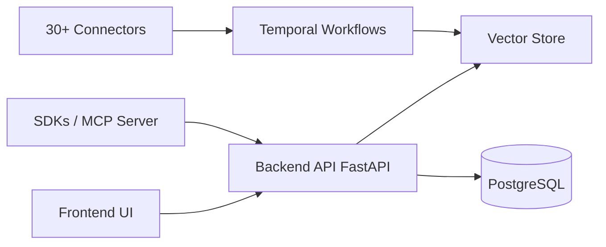

# airweave-ai/airweave

> Retrieval layer that syncs applications and databases to expose them to AI agents.

## The problem
Each agent rebuilds its own fragile pipelines for authentication, synchronization and indexing of sources.

## What it actually does
Connectors to 50+ applications, continuous synchronization orchestrated by Temporal, vector indexing.
Unified search exposed through Python/TS SDKs, REST API, CLI and MCP server.
FastAPI backend, PostgreSQL for metadata, Vespa (or Qdrant depending on the code analysis) for vectors.
The repository is archived.

## How it is wired


## Trying it
```bash
git clone https://github.com/airweave-ai/airweave.git
cd airweave
./start.sh
pip install airweave-sdk
pip install airweave-cli
airweave search "quarterly revenue figures" --collection finance-data
```

## Cost and gotchas
Free self-hosting via Docker; cloud version at app.airweave.ai.
Archived repository: no more fixes or updated connectors.

## What it is not
Not a living project: do not build on it.
Not a simple vector store: a full platform to operate.

## Alternatives
No alternative named in the README.

## For you
Ignore: the idea of unified retrieval for agents is good, but an archived repository is an unnecessary risk.
