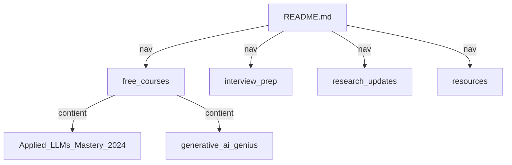

# aishwaryanr/awesome-generative-ai-guide

> Hub of courses, papers, notebooks and interview prep on generative AI.

## The problem
The literature on LLMs, RAG and agents is scattered, and it is unclear where to start or at what level.

## What it actually does
A README that organizes content into three tracks (use, build, understand AI) and three levels (101, 201, 301), with pages by topic: foundations, RAG, fine-tuning, agents, evaluation, security. It contains free LevelUp Labs courses, a role-based interview prep section, monthly paper lists and a glossary. Some courses lead to paid cohort offerings.

## How it is wired


## Trying it
```bash
# Aucune commande documentée : on suit les liens du README.
```

## Cost and gotchas
Content is free, but the courses are hosted elsewhere and some live courses are paid. The README states that access terms vary by provider.

## What it is not
Not a library or a single coherent course: it is an index. The repo has no code to run, apart from linked notebooks.

## Alternatives
No alternative named in the README.

## For you
Keep it handy for upskilling or preparing for an AI interview; occasional reading, by a single author.
