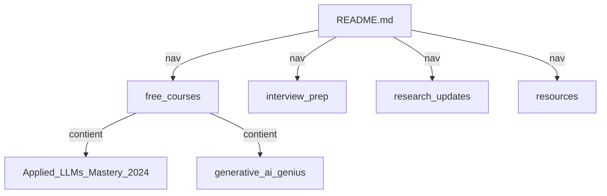

# aishwaryanr/awesome-generative-ai-guide

> Hub de cours, de papiers, de notebooks et de préparation d'entretiens sur l'IA générative.

## Le problème
La littérature sur les LLM, la RAG et les agents est dispersée, et on ne sait pas par où commencer ni à quel niveau.

## Ce que ça fait vraiment
Un README qui organise le contenu en trois parcours (utiliser, construire, comprendre l'IA) et trois niveaux (101, 201, 301), avec des pages par sujet : fondations, RAG, fine-tuning, agents, évaluation, sécurité. Il contient des cours gratuits de LevelUp Labs, un pôle de préparation d'entretiens par rôle, des listes mensuelles de papiers et un glossaire. Certains cours mènent à des offres payantes en cohortes.

## Comment c'est branché


## Essayer
```bash
# Aucune commande documentée : on suit les liens du README.
```

## Coût et pièges
Contenu gratuit, mais les cours sont hébergés ailleurs et certains cours en direct sont payants. Le README précise que les conditions d'accès varient selon le fournisseur.

## Ce que ce n'est pas
Ce n'est pas une bibliothèque ni un cours unique et cohérent : c'est un index. Le dépôt n'a aucun code à exécuter, hormis des notebooks liés.

## Alternatives
Aucune alternative nommée dans le README.

## Pour toi
À garder sous la main pour monter en compétence ou préparer un entretien IA ; lecture ponctuelle, par une seule autrice.

