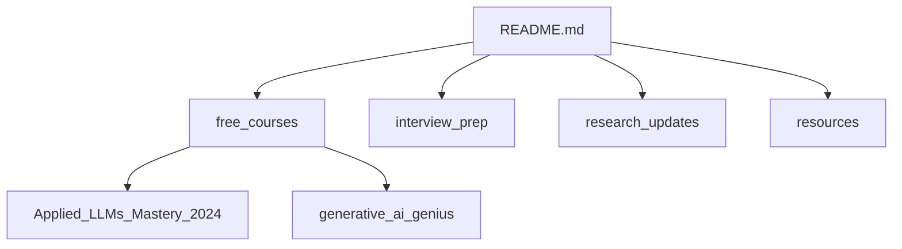

# aishwaryanr/awesome-generative-ai-guide

> Dépôt de liens, cours et fiches d'entretien sur l'IA générative, organisé par parcours et niveau.

## Le problème
Les ressources sur les LLM sont dispersées et sans ordre de lecture. Il est difficile de savoir par où commencer selon son objectif.

## Ce que ça fait vraiment
Le README oriente vers trois parcours (utiliser, construire, comprendre la recherche), chacun en niveaux 101 à 301. Il contient aussi des pages par sujet (RAG, agents, évaluation…), des préparations d'entretien par rôle, des listes mensuelles d'articles et des cours gratuits de l'autrice (LevelUp Labs), à côté d'offres payantes en cohorte.

## Comment c'est branché

## Essayer
Aucune commande : on lit le README et on suit les liens.

## Coût et pièges
Contenu gratuit ; les cours en cohorte sur Maven sont payants et le README annonce que les conditions d'accès varient selon les listings. Certaines ressources sont archivées (édition 2024).

## Ce que ce n'est pas
Ce n'est pas du code ni une bibliothèque. C'est aussi un catalogue partiellement promotionnel pour les cours de l'autrice.

## Alternatives
Aucune alternative nommée dans le README.

## Pour toi
À surveiller : utile comme index de montée en compétence RAG, agents et évaluation, mais à prendre comme point d'entrée éditorial, pas comme référence technique.

