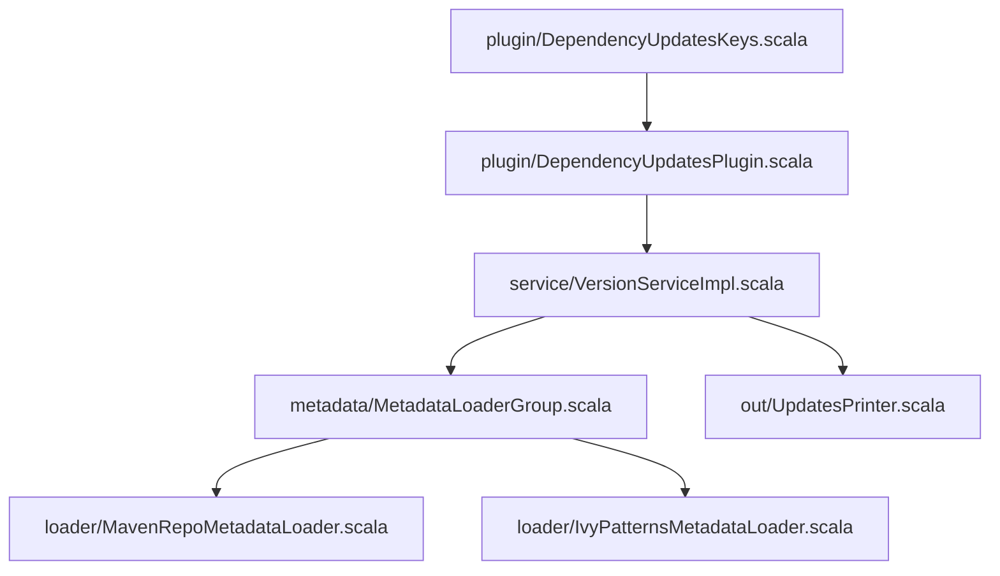

# aiyanbo/sbt-dependency-updates

> sbt plugin that lists, and offers to update, the outdated dependencies and plugins of a Scala project.

## The problem
Knowing which dependencies of an sbt build have a newer version without browsing the repositories by hand.

## What it actually does
Two tasks: dependencyUpdates displays the possible updates; dependencyUpgrade, marked experimental, applies them in project/Dependencies.scala. Loaders query Maven metadata, Maven search and Ivy patterns.

## How it is wired


## Trying it
```bash
# Dans project/plugins.sbt :
addSbtPlugin("org.jmotor.sbt" % "sbt-dependency-updates" % "1.2.9")
# Puis dans sbt : dependencyUpdates
```

## Cost and gotchas
Free. Last push on 21 November 2025, more than a year ago: slow follow-up. The only apparent maintainer is one person.

## What it is not
Not a generic Python or JVM tool: it only serves sbt builds.

## Alternatives
- No alternative named in the README.

## For you
Ignore: exclusively for Scala/sbt, and not very active.
