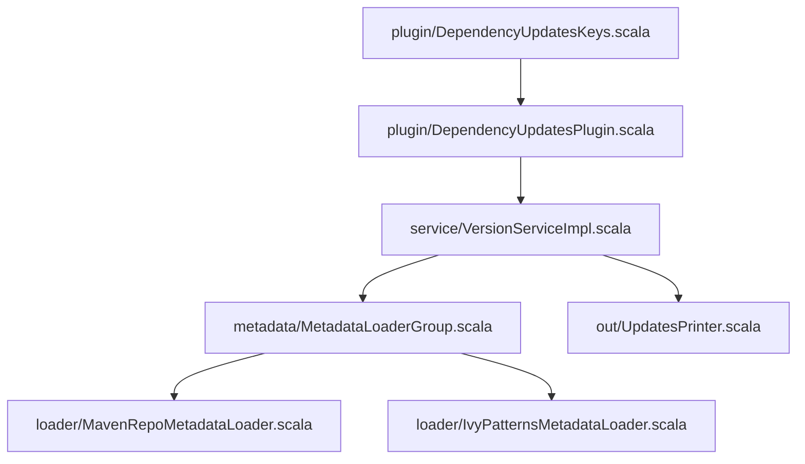

# aiyanbo/sbt-dependency-updates

> Plugin sbt qui liste, et propose de mettre à jour, les dépendances et plugins obsolètes d'un projet Scala.

## Le problème
Savoir quelles dépendances d'un build sbt ont une version plus récente sans parcourir les dépôts à la main.

## Ce que ça fait vraiment
Deux tâches : dependencyUpdates affiche les mises à jour possibles ; dependencyUpgrade, marquée expérimentale, les applique dans project/Dependencies.scala. Des chargeurs interrogent les métadonnées Maven, la recherche Maven et les motifs Ivy.

## Comment c'est branché


## Essayer
```bash
# Dans project/plugins.sbt :
addSbtPlugin("org.jmotor.sbt" % "sbt-dependency-updates" % "1.2.9")
# Puis dans sbt : dependencyUpdates
```

## Coût et pièges
Gratuit. Dernier push le 21 novembre 2025, soit plus d'un an : suivi lent. Le seul mainteneur apparent est une personne.

## Ce que ce n'est pas
Pas un outil Python ou JVM générique : il ne sert qu'aux builds sbt.

## Alternatives
- Aucune alternative nommée dans le README.

## Pour toi
Ignorer : exclusivement pour Scala/sbt, et peu actif.

