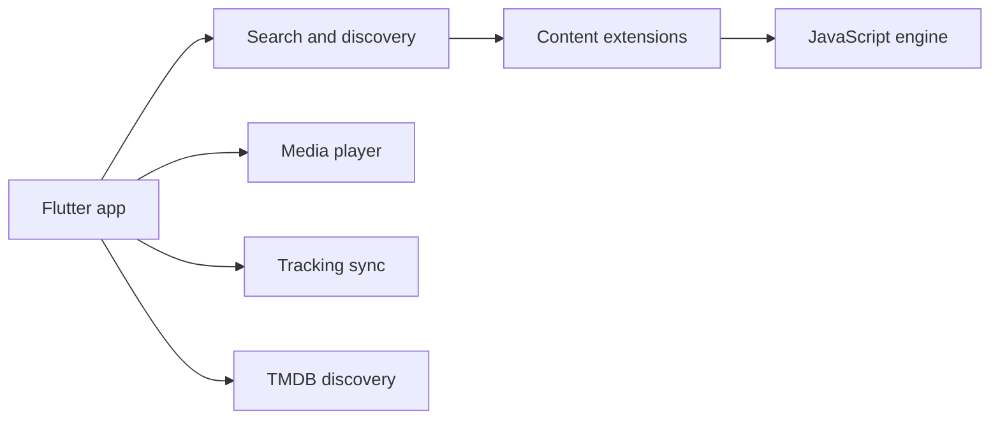

# akashdh11/skystream

> Cross-platform Flutter streaming client whose sources come from extensions installed by the user.

## The problem
Existing extension-based streaming clients do not cover all systems with a single codebase.

## What it actually does
Search and discovery via TMDB and extensions, playback with resume, downloads, external subtitles, Trakt, Simkl, MAL and AniList tracking, intro skipping. Four extension types: SkyStream (JavaScript), CloudStream `.cs3`, Nuvio and Stremio. No default source. According to the architecture, the repository does not expose the application's Flutter code.

## How it is wired


## Trying it
```bash
git clone https://github.com/akashdh11/skystream.git
cd skystream
flutter pub get
flutter gen-l10n
dart run build_runner build --delete-conflicting-outputs
flutter run
```

## Cost and gotchas
Free. Without extensions, no content. The README asks not to use extensions that host copyrighted content. On iOS: installation by sideloading.

## What it is not
Not a content provider nor an official CloudStream client. Copyright risks depend on the installed extensions.

## Alternatives
CloudStream (source of inspiration, whose extensions it reads).

## For you
Ignore: consumer streaming client unrelated to data or AI, with a legal risk on the extensions side.
