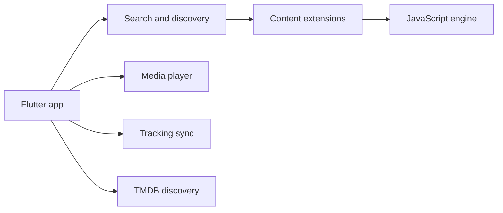

# akashdh11/skystream

> Client de streaming Flutter multiplateforme dont les sources viennent d'extensions que l'utilisateur installe.

## Le problème
Les clients de streaming à extensions existants ne couvrent pas tous les systèmes avec un même code.

## Ce que ça fait vraiment
Recherche et découverte via TMDB et extensions, lecture avec reprise, téléchargements, sous-titres externes, suivi Trakt, Simkl, MAL et AniList, saut d'intro. Quatre types d'extensions : SkyStream (JavaScript), CloudStream `.cs3`, Nuvio et Stremio. Aucune source par défaut. Le dépôt n'expose pas le code Flutter de l'application d'après l'architecture.

## Comment c'est branché


## Essayer
```bash
git clone https://github.com/akashdh11/skystream.git
cd skystream
flutter pub get
flutter gen-l10n
dart run build_runner build --delete-conflicting-outputs
flutter run
```

## Coût et pièges
Gratuit. Sans extension, aucun contenu. Le README demande de ne pas utiliser d'extensions hébergeant du contenu protégé. Sur iOS : installation par sideloading.

## Ce que ce n'est pas
Pas un fournisseur de contenu ni un client officiel de CloudStream. Les risques de droits d'auteur dépendent des extensions installées.

## Alternatives
CloudStream (source d'inspiration, dont il lit les extensions).

## Pour toi
À ignorer : client de streaming grand public sans rapport avec la data ou l'IA, avec un risque juridique côté extensions.

