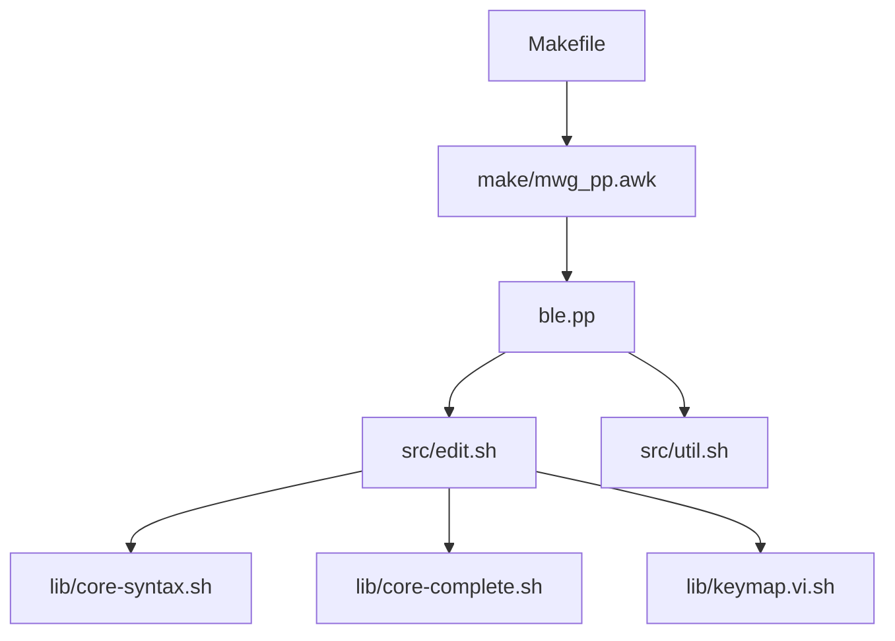

# akinomyoga/ble.sh

> Line editor written in pure Bash that replaces Readline, with highlighting and autocompletion.

## The problem
Default Bash has neither syntax highlighting nor suggestions like fish or zsh.

## What it actually does
ble.sh replaces GNU Readline: syntax highlighting, richer completion (menu, auto-completion, abbreviations), full vim mode, right-hand prompt, status line. A `make` merges the scripts in `src` into a single `ble.sh`. It redefines a few builtins (`trap`, `readonly`, `bind`, `history`, `read`, `exit`) and requires Bash 3.0 at minimum, 4.0 recommended.

## How it is wired


## Trying it
```bash
git clone --recursive --depth 1 --shallow-submodules https://github.com/akinomyoga/ble.sh.git
make -C ble.sh
source ble.sh/out/ble.sh
# installation
make -C ble.sh install PREFIX=~/.local
echo 'source -- ~/.local/share/blesh/ble.sh' >> ~/.bashrc
```

## Cost and gotchas
Free. Requires git, GNU make and gawk. The devel version is at 0.4, the stable releases are old. The README mentions a possible conflict with fzf and a cache to clear if input freezes.

## What it is not
Not a configuration framework: no prompt or aliases provided. Not a new shell, only a layer for Bash.

## Alternatives
The README cites fish and zsh-syntax-highlighting as references for features, without offering them as replacements.

## For you
Watch: a real comfort for anyone living in Bash on servers or containers, but with no effect on the data work itself.
