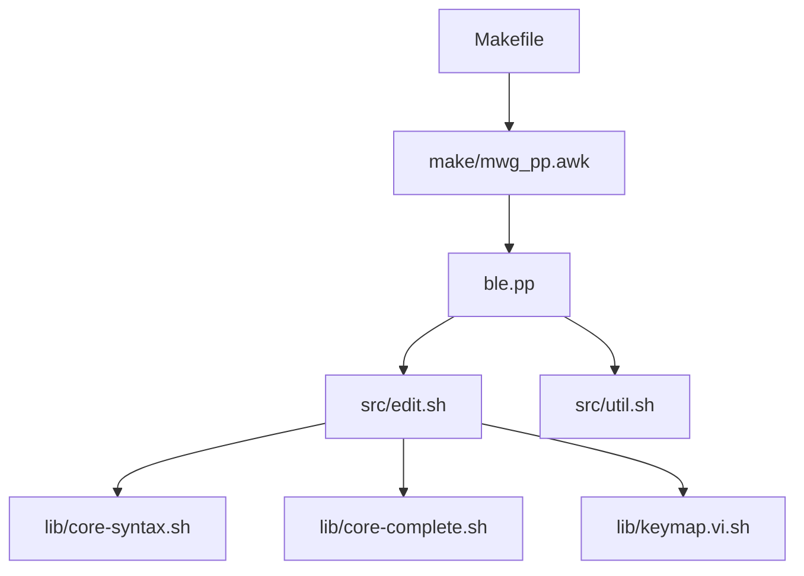

# akinomyoga/ble.sh

> Éditeur de ligne écrit en Bash pur, qui remplace Readline avec coloration et autocomplétion.

## Le problème
Le Bash par défaut n'a ni coloration syntaxique, ni suggestions comme fish ou zsh.

## Ce que ça fait vraiment
ble.sh remplace GNU Readline : coloration syntaxique, complétion enrichie (menu, auto-complétion, abréviations), mode vim complet, prompt à droite, ligne d'état. Un `make` fusionne les scripts de `src` en un seul `ble.sh`. Il redéfinit quelques builtins (`trap`, `readonly`, `bind`, `history`, `read`, `exit`) et demande Bash 3.0 minimum, 4.0 conseillé.

## Comment c'est branché


## Essayer
```bash
git clone --recursive --depth 1 --shallow-submodules https://github.com/akinomyoga/ble.sh.git
make -C ble.sh
source ble.sh/out/ble.sh
# installation
make -C ble.sh install PREFIX=~/.local
echo 'source -- ~/.local/share/blesh/ble.sh' >> ~/.bashrc
```

## Coût et pièges
Gratuit. Il faut git, GNU make et gawk. La version devel est en 0.4, les versions stables sont anciennes. Le README signale un conflit possible avec fzf et un cache à vider si la saisie se bloque.

## Ce que ce n'est pas
Pas un framework de configuration : pas de prompt ni d'alias fournis. Ce n'est pas un nouveau shell, seulement une couche pour Bash.

## Alternatives
Le README cite fish et zsh-syntax-highlighting comme références de fonctions, sans les proposer en remplacement.

## Pour toi
Surveiller : un confort réel pour qui vit dans Bash sur des serveurs ou des conteneurs, mais sans effet sur le travail data lui-même.

