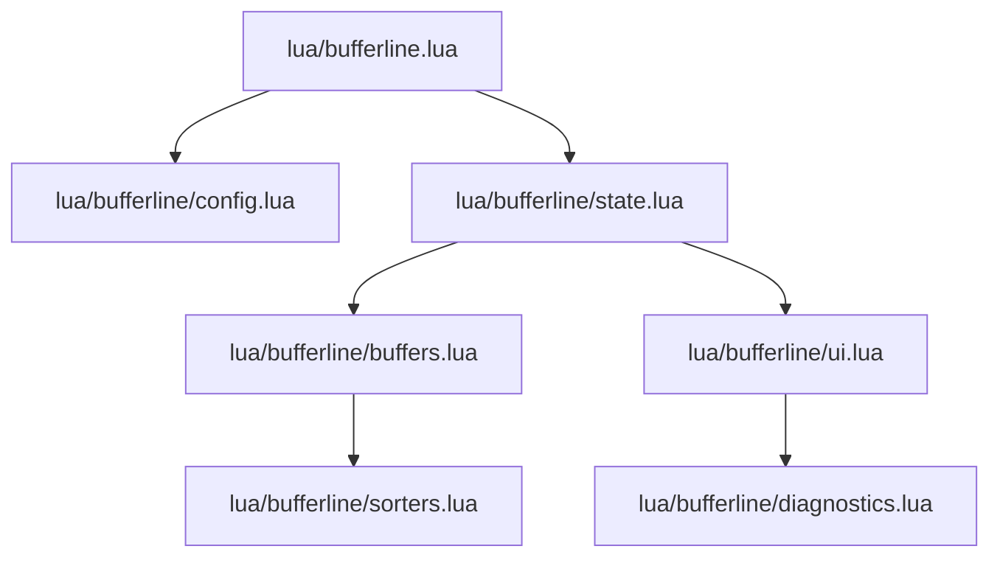

# akinsho/bufferline.nvim

> Neovim plugin that displays open buffers like graphical editor tabs.

## The problem
By default, Neovim does not show the list of open files the way graphical editors do.

## What it actually does
It replaces the tabline with a list of buffers, with colors taken from the theme, sorting, grouping, pinning, numbering, reordering, offset for sidebars and LSP error indicators. A `tabs` mode displays tab pages, without sorting or groups.

## How it is wired
Diagram based on the provided diagram.



## Trying it
```lua
-- lazy.nvim
{'akinsho/bufferline.nvim', version = "*", dependencies = 'nvim-tree/nvim-web-devicons'}

vim.opt.termguicolors = true
require("bufferline").setup{}
```

## Cost and gotchas
Free. Neovim 0.8+, a patched font (Nerd Fonts) and `termguicolors`. Last push in January 2025, GPL-3.0 license. Conflicts with airline or lightline.

## What it is not
Not a project manager. The author warns that the style is opinionated and that few features will be added. Seeing only the buffers of one tab requires scope.nvim.

## Alternatives
- scope.nvim: to add for buffers limited to each tab.

## For you
Ignore unless you like the look: a single maintainer, a last push over a year ago and a GPL license, while the tab bar brings nothing to your pipelines.
