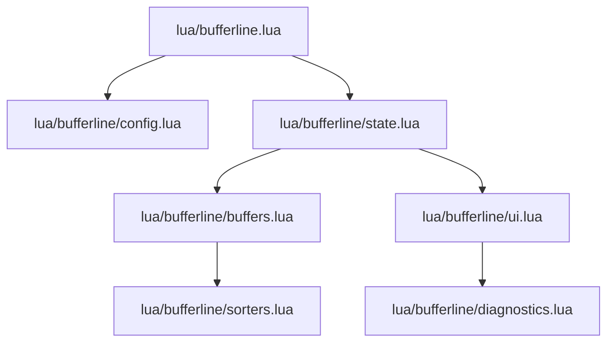

# akinsho/bufferline.nvim

> Plugin Neovim qui affiche les buffers ouverts comme des onglets d'éditeur graphique.

## Le problème
Neovim n'affiche pas par défaut la liste des fichiers ouverts comme le font les éditeurs graphiques.

## Ce que ça fait vraiment
Il remplace la ligne d'onglets par une liste de buffers, avec couleurs tirées du thème, tri, regroupement, épinglage, numérotation, réordonnancement, décalage pour les barres latérales et indicateurs d'erreurs LSP. Un mode `tabs` affiche les pages d'onglets, sans tri ni groupes.

## Comment c'est branché
Schéma d'après le diagramme fourni.



## Essayer
```lua
-- lazy.nvim
{'akinsho/bufferline.nvim', version = "*", dependencies = 'nvim-tree/nvim-web-devicons'}

vim.opt.termguicolors = true
require("bufferline").setup{}
```

## Coût et pièges
Gratuit. Neovim 0.8+, police patchée (Nerd Fonts) et `termguicolors`. Dernier push en janvier 2025, licence GPL-3.0. Entre en conflit avec airline ou lightline.

## Ce que ce n'est pas
Pas un gestionnaire de projet. L'auteur prévient que le style est opiniâtre et qu'il ajoutera peu de fonctions. Voir seulement les buffers d'un onglet nécessite scope.nvim.

## Alternatives
- scope.nvim : à ajouter pour des buffers limités à chaque onglet.

## Pour toi
À ignorer sauf goût esthétique : un mainteneur unique, un dernier push de plus d'un an et une licence GPL, alors que la barre d'onglets n'apporte rien à tes pipelines.

