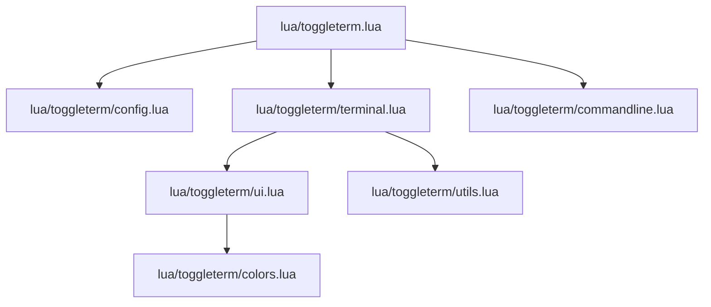

# akinsho/toggleterm.nvim

> Neovim plugin to open, hide and manage several persistent terminals inside the editor.

## The problem
Neovim's built-in terminal is not very ergonomic: starting a background process and returning to it on demand takes too many steps.

## What it actually does
It adds floating, vertical, horizontal or tab terminals, numbered, which you switch with a shortcut. The `ToggleTerm`, `TermExec`, `TermNew` and `TermSelect` commands let you control several of them, send lines of code to them and tint them. The `Terminal` class is used to launch interfaces such as lazygit or htop.

## How it is wired


## Trying it
```bash
Plug 'akinsho/toggleterm.nvim', {'tag' : '*'}
```
Then, in Neovim: `lua require("toggleterm").setup()`.

## Cost and gotchas
Free. Neovim 0.7 or later; you must call `setup` explicitly and pin a tag to avoid breaking changes. Last push in March 2025, so more than a year ago. GPL-3.0 license.

## What it is not
Not a full multiplexer: several terminals with different directions open together are not supported. Some options (winbar) are marked experimental.

## Alternatives
No alternative named in the README.

## For you
Ignore unless you work in Neovim: an editor convenience with no effect on your data or MLOps projects, and rarely updated.
