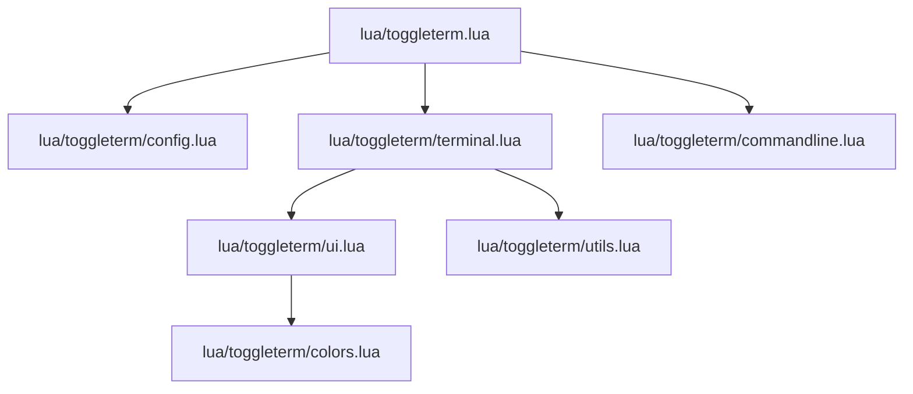

# akinsho/toggleterm.nvim

> Extension Neovim pour ouvrir, masquer et gérer plusieurs terminaux persistants dans l'éditeur.

## Le problème
Le terminal intégré de Neovim est peu ergonomique : lancer un processus en arrière-plan et y revenir à la demande demande trop de gestes.

## Ce que ça fait vraiment
Elle ajoute des terminaux flottants, verticaux, horizontaux ou en onglet, numérotés, qu'on bascule avec un raccourci. Les commandes `ToggleTerm`, `TermExec`, `TermNew` et `TermSelect` permettent d'en piloter plusieurs, d'y envoyer des lignes de code et de les teinter. La classe `Terminal` sert à lancer des interfaces comme lazygit ou htop.

## Comment c'est branché


## Essayer
```bash
Plug 'akinsho/toggleterm.nvim', {'tag' : '*'}
```
Puis, dans Neovim : `lua require("toggleterm").setup()`.

## Coût et pièges
Gratuit. Neovim 0.7 ou plus ; il faut appeler `setup` explicitement et fixer un tag pour éviter les changements cassants. Dernier push en mars 2025, donc plus d'un an. Licence GPL-3.0.

## Ce que ce n'est pas
Ce n'est pas un multiplexeur complet : plusieurs terminaux de directions différentes ouverts ensemble ne sont pas pris en charge. Certaines options (winbar) sont marquées expérimentales.

## Alternatives
Aucune alternative nommée dans le README.

## Pour toi
À ignorer sauf si tu travailles sous Neovim : un confort d'éditeur sans effet sur tes projets data ou MLOps, et peu mis à jour.

