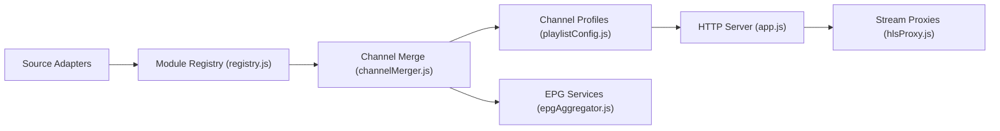

# akiralereal/iptv

> A self-hosted server that aggregates IPTV channel sources and serves M3U playlists and an EPG guide.

## The problem
Gathering scattered TV sources (platforms, regional channels, M3U subscriptions) into a clean list adapted to each player.

## What it actually does
A Node application that launches per-platform extraction modules (CCTV, Migu, Bilibili, Huya, Douyu, Chinese regional channels, etc.), merges and deduplicates channels, manages profiles, user tokens and EPG, then serves M3U, TXT and XMLTV through HLS/FLV proxies. A headless Chromium browser is used to extract some sources. Browser-based administration interface.

## How it is wired


## Trying it
```bash
docker compose up -d
docker compose pull && docker compose up -d
node app.js
```
With the README's `docker-compose.yml` (image `akiralereal/iptv:latest`, port 1905, volume `./data`).

## Cost and gotchas
Free. The README insists: public addresses do not grant broadcasting rights; the user is responsible for the sources. Some channels require cookies from personal accounts and Chromium uses 200 to 400 MB each.

## What it is not
Provides no licensed content: it aggregates third-party links. README in Chinese, content targeting mainland China networks.

## Alternatives
No alternative named in the README.

## For you
Ignore: a TV utility unrelated to data/AI/MLOps, with copyright risks on the sources.
