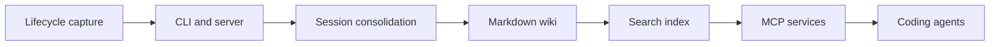

# akitaonrails/ai-memory

> Long-term memory shared across coding agents, machines and teams, stored as a markdown wiki.

## The problem
When you switch agent, machine or session, you have to re-explain the architecture, the approaches that failed and the open questions.

## What it actually does
Hooks capture prompts and tool calls and clean them, then at the end of a session the server compiles them into markdown pages in a git-versioned wiki. The next agent receives a bounded summary and a typed handoff to be claimed only once. FTS5 search, entities, graph and optional vectors. Works without any LLM call by default. Aging and deduplication without an LLM, optional LLM "dreaming". More than twenty harnesses supported; `ai-memory run` ensures continuity across harnesses.

## How it is wired


## Trying it
```bash
curl -fsSL https://github.com/akitaonrails/ai-memory/releases/latest/download/install.sh | sh
ai-memory setup
ai-memory run claude
```

## Cost and gotchas
Free, no API key by default. The quick-start Docker has no authentication (loopback binding only). An external LLM or embeddings are optional and billed by the provider. Only one server per data directory.

## What it is not
Not an opaque fact store: the pages are files that belong to you. Does not handle transcripts from another machine for native session resume.

## Alternatives
The README compares with Mem0, Zep/Graphiti, mcp-memory-service, basic-memory, Hindsight/OpenViking and Supermemory.

## For you
Adopt: local, readable agent memory with no LLM cost, suited to an MLOps workflow where you alternate between agents; there is a single maintainer.
