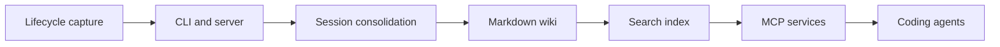

# akitaonrails/ai-memory

> Mémoire à long terme partagée entre agents de code, machines et équipes, stockée en wiki markdown.

## Le problème
Quand on change d'agent, de machine ou de session, il faut réexpliquer l'architecture, les approches qui ont échoué et les questions ouvertes.

## Ce que ça fait vraiment
Des hooks capturent prompts et appels d'outils, les nettoient puis, à la fin de session, le serveur les compile en pages markdown dans un wiki versionné par git. Le prochain agent reçoit un résumé borné et une relève typée à réclamer une seule fois. Recherche FTS5, entités, graphe et vecteurs optionnels. Fonctionne sans appel LLM par défaut. Vieillissement et déduplication sans LLM, « rêve » LLM optionnel. Plus de vingt harnais pris en charge ; `ai-memory run` assure la continuité entre harnais.

## Comment c'est branché


## Essayer
```bash
curl -fsSL https://github.com/akitaonrails/ai-memory/releases/latest/download/install.sh | sh
ai-memory setup
ai-memory run claude
```

## Coût et pièges
Gratuit, sans clé API par défaut. Le Docker de démarrage rapide n'a pas d'authentification (liaison loopback seulement). Un LLM ou des embeddings externes sont optionnels et facturés par le fournisseur. Un seul serveur par répertoire de données.

## Ce que ce n'est pas
Pas un magasin de faits opaques : les pages sont des fichiers à toi. Ne gère pas les transcriptions d'une autre machine pour la reprise de session native.

## Alternatives
Le README compare avec Mem0, Zep/Graphiti, mcp-memory-service, basic-memory, Hindsight/OpenViking et Supermemory.

## Pour toi
À adopter : mémoire d'agent locale, lisible et sans coût de LLM, adaptée à un flux MLOps où l'on alterne les agents ; le mainteneur est unique.

