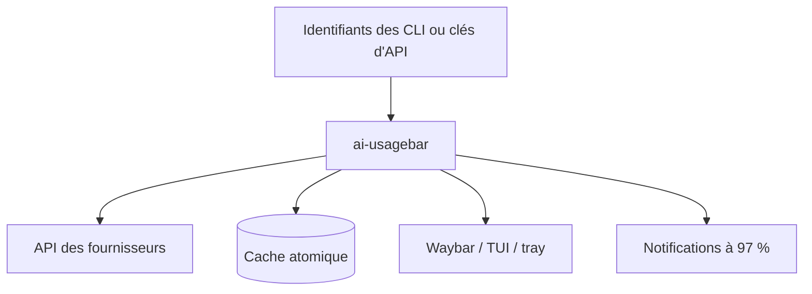

# akitaonrails/ai-usagebar

> Waybar widget, panel and terminal interface displaying usage quotas for many AI services.

## The problem
Quotas for several AI subscriptions have to be checked on as many separate dashboards, and you hit the limit without warning.

## What it actually does
A Rust port of `claudebar`, the tool reads the credentials of the official CLIs (Claude, Codex, Copilot and others) or API keys, queries the services and displays the quotas. It offers a Waybar module, a TUI, Omarchy, GNOME and KDE integrations, and a macOS or Windows notification area icon. An alert fires at 97%.

## How it is wired
Simplified diagram based on the sheet, no diagram provided.



## Trying it
```bash
cargo install ai-usagebar
nix run github:akitaonrails/ai-usagebar
yay -S ai-usagebar-bin
scoop install ai-usagebar
```

## Cost and gotchas
Free, but each provider requires an existing credential or key; most must be enabled by hand. Tokens are only read, never written. The README is truncated here: the end was not seen.

## What it is not
Not a billing or limiting tool. The Waybar widget does not work on Windows.

## Alternatives
- claudebar: the original tool, of which this one is a compatible port.

## For you
Worth watching: handy if you juggle several AI subscriptions, but it depends on each service's unofficial APIs and on a single maintainer.
