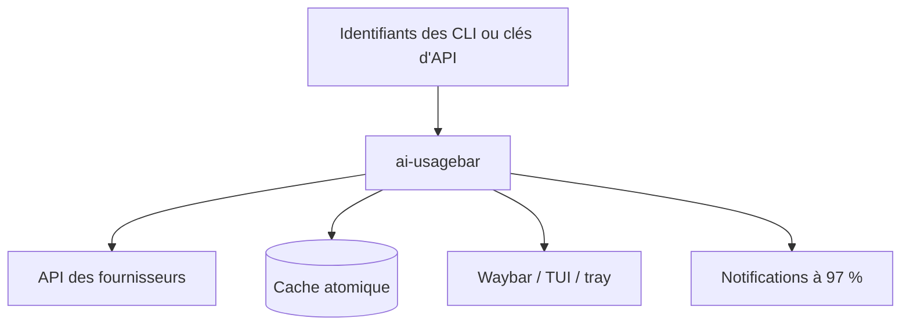

# akitaonrails/ai-usagebar

> Widget Waybar, panneau et interface terminal affichant les quotas d'usage de nombreux services IA.

## Le problème
Les quotas de plusieurs abonnements IA se vérifient sur autant de tableaux de bord séparés, et on atteint la limite sans prévenir.

## Ce que ça fait vraiment
Port en Rust de `claudebar`, l'outil lit les identifiants des CLI officielles (Claude, Codex, Copilot et d'autres) ou des clés d'API, interroge les services et affiche les quotas. Il propose un module Waybar, une interface TUI, des intégrations Omarchy, GNOME, KDE et une zone de notification macOS ou Windows. Une alerte arrive à 97 %.

## Comment c'est branché
Schéma simplifié d'après la fiche, sans diagramme fourni.



## Essayer
```bash
cargo install ai-usagebar
nix run github:akitaonrails/ai-usagebar
yay -S ai-usagebar-bin
scoop install ai-usagebar
```

## Coût et pièges
Gratuit, mais chaque fournisseur demande un identifiant ou une clé existants ; la plupart sont à activer à la main. Les jetons ne sont lus qu'en lecture seule. Le README est tronqué ici : la fin n'a pas été vue.

## Ce que ce n'est pas
Pas un outil de facturation ni de limitation. Le widget Waybar ne fonctionne pas sous Windows.

## Alternatives
- claudebar : l'outil d'origine, dont celui-ci est un port compatible.

## Pour toi
À surveiller : pratique si tu jongles avec plusieurs abonnements IA, mais il dépend des API non officielles de chaque service et d'un seul mainteneur.

