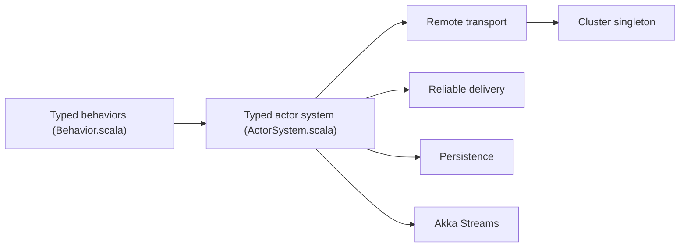

# akka/akka-core

> Akka actor-model libraries for building resilient distributed systems in Scala and Java.

## The problem
Writing correct concurrent and distributed code with hand-made locks and networking is hard.

## What it actually does
An actor model handles multithreading without locks, transparent remote communication and clustering. The repository contains classic and typed actors, reliable delivery, cluster, persistence, persistence queries, Akka Streams and remote transport. The README also presents the Akka SDK and a managed service (Akka Automated Operations).

## How it is wired

## Trying it
The README contains no command: it points to doc.akka.io. No command documented.

## Cost and gotchas
The license is the Business Source License 1.1 (the README says so): use subject to conditions, to be read before any commercial use. Tests and documentation have a separate license. 901 open issues.

## What it is not
Not an open source tool in the classic sense despite the public repository. Not the Akka SDK nor the managed offering, which are separate products.

## Alternatives
No alternative named in the README.

## For you
Worth watching: powerful for JVM distributed systems, but the BSL requires a legal review before adoption.
