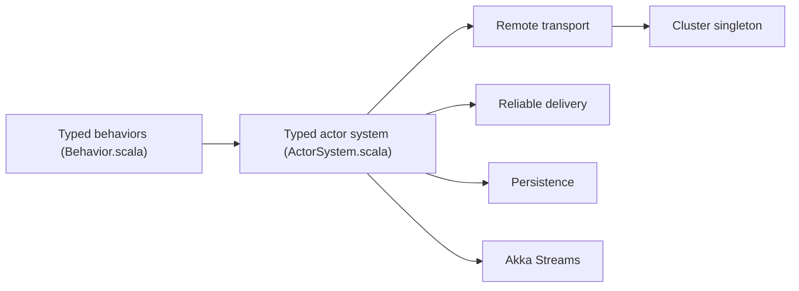

# akka/akka-core

> Bibliothèques Akka de modèle d'acteurs pour construire des systèmes distribués résilients en Scala et Java.

## Le problème
Écrire du code concurrent et distribué correct avec verrous et réseau à la main est difficile.

## Ce que ça fait vraiment
Un modèle d'acteurs gère le multithread sans verrous, la communication distante transparente et le clustering. Le dépôt contient les acteurs classiques et typés, la livraison fiable, le cluster, la persistance, les requêtes de persistance, Akka Streams et le transport distant. Le README présente aussi l'Akka SDK et un service géré (Akka Automated Operations).

## Comment c'est branché

## Essayer
Le README ne contient aucune commande : il renvoie à doc.akka.io. Aucune commande documentée.

## Coût et pièges
La licence est la Business Source License 1.1 (le README le dit) : usage soumis à conditions, à lire avant tout usage commercial. Tests et documentation ont une licence séparée. 901 issues ouvertes.

## Ce que ce n'est pas
Pas un outil open source au sens classique malgré le dépôt public. Pas l'Akka SDK ni l'offre gérée, qui sont des produits distincts.

## Alternatives
Aucune alternative nommée dans le README.

## Pour toi
À surveiller : puissant pour des systèmes distribués JVM, mais la BSL impose une relecture juridique avant adoption.

