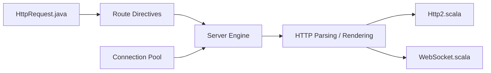

# akka/akka-http

> Server and client HTTP toolkit in Scala/Java on top of Akka Actor and Streams.

## The problem
Writing HTTP services in Scala or Java with routing, HTTP/2 and WebSocket without an imposed web framework.

## What it actually does
Processes HTTP messages (parsing, rendering), routes server requests to a response, handles client connections with a pool, HTTP/2, WebSocket, route caching. Several API levels, from high to low level. The README states that it is not a web framework.

## How it is wired

## Trying it
No command documented in the README: it points to doc.akka.io/libraries.

## Cost and gotchas
Free to use, but the README announces the Business Source License 1.1 (tests and docs under a separate license): read the license FAQ before commercial use. 581 open issues.

## What it is not
Not a web framework nor browser-first. Not a complete platform: the Akka SDK and managed operations are separate products.

## Alternatives
No alternative named in the README.

## For you
Ignore: a JVM/Scala stack under the BSL license, unrelated to data/AI work in Python; useful only if you maintain existing Scala.
