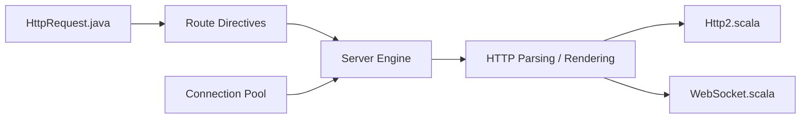

# akka/akka-http

> Boîte à outils HTTP serveur et client en Scala/Java au-dessus d'Akka Actor et Streams.

## Le problème
Écrire des services HTTP en Scala ou Java avec routage, HTTP/2 et WebSocket sans framework web imposé.

## Ce que ça fait vraiment
Traite des messages HTTP (analyse, rendu), route les requêtes serveur vers une réponse, gère des connexions client avec pool, HTTP/2, WebSocket, cache de routes. Plusieurs niveaux d'API, du haut au bas niveau. Le README précise que ce n'est pas un framework web.

## Comment c'est branché

## Essayer
Aucune commande documentée dans le README : renvoie à doc.akka.io/libraries.

## Coût et pièges
Gratuit à l'usage, mais le README annonce la Business Source License 1.1 (tests et docs sous licence séparée) : lire la FAQ licence avant un usage commercial. 581 issues ouvertes.

## Ce que ce n'est pas
Pas un framework web ni un navigateur-first. Pas une plateforme complète : l'Akka SDK et les opérations managées sont des produits à part.

## Alternatives
Aucune alternative nommée dans le README.

## Pour toi
À ignorer : pile JVM/Scala sous licence BSL, sans lien avec un travail data/IA en Python ; utile seulement si tu maintiens du Scala existant.

