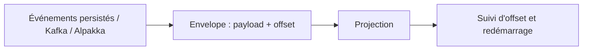

# akka/akka-projection

> Akka library for consuming event streams with offset tracking, in Scala and Java.

## The problem
Consuming an event stream (persisted events, Kafka) while remembering where you stopped, with resumption and distribution.

## What it actually does
Abstracts a stream of envelopes (payload and offset) coming from persisted events, Kafka topics or Alpakka connectors. Provides tools to track, restart and distribute these projections. Part of the Akka libraries.

## How it is wired
Simplified diagram based on the sheet, no diagram provided.

## Trying it
No command documented in the README: local compilation requires an Akka token placed in `~/.sbt/1.0/akka-commercial.sbt`.

## Cost and gotchas
Business Source License 1.1 (the catalogue reports an unidentified license). Token to be obtained from account.akka.io in order to compile. Tests and documentation are under a separate license.

## What it is not
Not a full stream-processing engine nor a Python tool. Not a classic open-source license.

## Alternatives
None named in the README.

## For you
Ignore: JVM library under a commercial license, far from everyday Python data / AI work.
