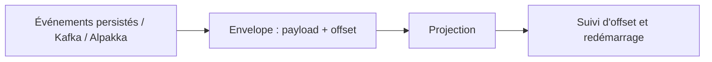

# akka/akka-projection

> Bibliothèque Akka pour consommer des flux d'événements avec suivi d'offset, en Scala et Java.

## Le problème
Consommer un flux d'événements (persistés, Kafka) en retenant où l'on s'est arrêté, avec reprise et distribution.

## Ce que ça fait vraiment
Abstrait un flux d'enveloppes (charge utile et offset) venant d'événements persistés, de topics Kafka ou de connecteurs Alpakka. Fournit des outils pour suivre, redémarrer et répartir ces projections. Fait partie des bibliothèques Akka.

## Comment c'est branché
Schéma simplifié d'après la fiche, sans diagramme fourni.

## Essayer
Pas de commande documentée dans le README : la compilation locale exige un jeton Akka placé dans `~/.sbt/1.0/akka-commercial.sbt`.

## Coût et pièges
Licence Business Source License 1.1 (le catalogue signale une licence non identifiée). Jeton à récupérer sur account.akka.io pour compiler. Tests et documentation sous une licence séparée.

## Ce que ce n'est pas
Pas un moteur de traitement de flux complet ni un outil Python. Pas une licence libre classique.

## Alternatives
Aucune nommée dans le README.

## Pour toi
Ignorer : bibliothèque JVM sous licence commerciale, loin d'un travail data / IA courant en Python.

