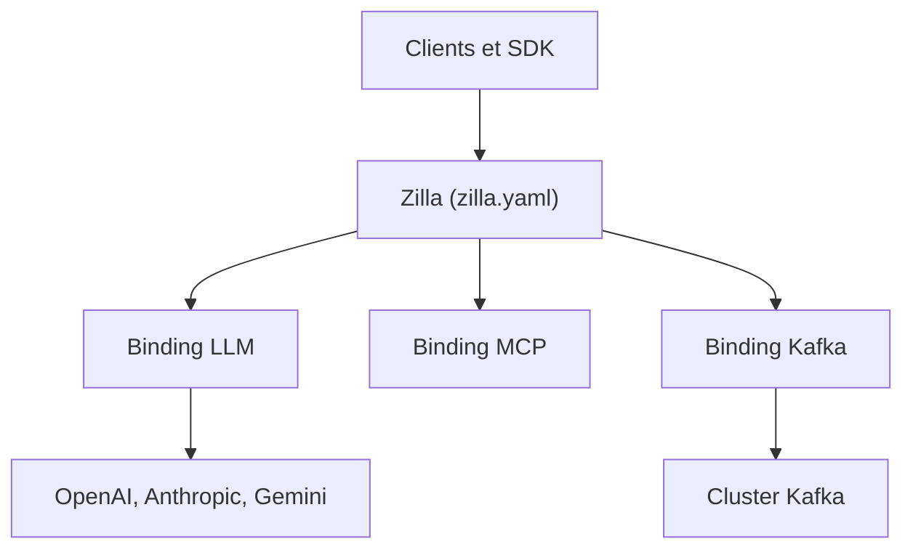

# aklivity/zilla

> Declarative gateway that connects apps and agents to LLMs, MCP tools and Kafka.

## The problem
Apps speak HTTP, agents speak MCP, data lives in Kafka: every bridge requires a custom adapter.

## What it actually does
Zilla chains "bindings" configured in `zilla.yaml`. On the LLM side, it routes by model, translates between the OpenAI, Anthropic and Gemini APIs, applies guardrails and exports token metrics. On the agent side, it exposes a single MCP endpoint aggregating MCP servers, OpenAPI services and Kafka capabilities. On the data side, it puts Kafka behind HTTP, SSE, WebSocket, gRPC and MQTT.

## How it is wired
Simplified diagram based on the sheet, no diagram provided.



## Trying it
```bash
git clone --depth 1 https://github.com/aklivity/zilla-demos.git
cd zilla-demos/llm.gateway
cp .env.example .env
docker compose up --build --wait
```

## Cost and gotchas
API keys for each provider are at your expense. The LLM fallback does not trigger on 429 or 5xx responses. Bedrock and the native Kafka proxy fall under Zilla Plus (license key). License present but unidentified: to be verified. 407 open issues.

## What it is not
Not an agent framework. The translation covers chat, streaming and tools, not every provider-specific parameter. The `docker run` and Helm commands do not generate any `zilla.yaml`.

## Alternatives
- No alternative named in the README.

## For you
Worth watching: an interesting LLM and MCP gateway for governing access to models, but the license needs clarifying and the YAML configuration has to be learned.
