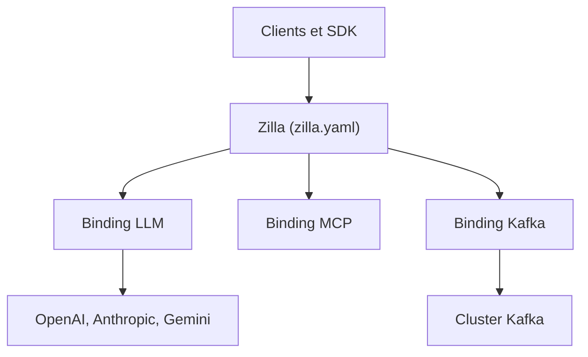

# aklivity/zilla

> Passerelle déclarative qui relie applis et agents aux LLM, aux outils MCP et à Kafka.

## Le problème
Les applis parlent HTTP, les agents MCP, les données vivent dans Kafka : chaque pont demande un adaptateur sur mesure.

## Ce que ça fait vraiment
Zilla enchaîne des « bindings » configurés dans `zilla.yaml`. Côté LLM, il route par modèle, traduit entre les API OpenAI, Anthropic et Gemini, applique des garde-fous et exporte des métriques de jetons. Côté agents, il expose un point MCP unique agrégeant serveurs MCP, services OpenAPI et capacités Kafka. Côté données, il met Kafka derrière HTTP, SSE, WebSocket, gRPC et MQTT.

## Comment c'est branché
Schéma simplifié d'après la fiche, sans diagramme fourni.



## Essayer
```bash
git clone --depth 1 https://github.com/aklivity/zilla-demos.git
cd zilla-demos/llm.gateway
cp .env.example .env
docker compose up --build --wait
```

## Coût et pièges
Clés d'API de chaque fournisseur à ta charge. Le fallback LLM ne se déclenche pas sur des réponses 429 ou 5xx. Bedrock et le proxy Kafka natif relèvent de Zilla Plus (clé de licence). Licence présente mais non identifiée : à vérifier. 407 issues ouvertes.

## Ce que ce n'est pas
Pas un framework d'agents. La traduction couvre le chat, le streaming et les outils, pas tous les paramètres propres à un fournisseur. Les commandes `docker run` et Helm ne génèrent aucun `zilla.yaml`.

## Alternatives
- Aucune alternative nommée dans le README.

## Pour toi
À surveiller : passerelle LLM et MCP intéressante pour gouverner l'accès aux modèles, mais licence à clarifier et configuration YAML à apprendre.

