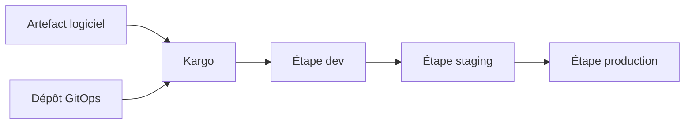

# akuity/kargo

> GitOps tool that automates the promotion of software artifacts between the stages of their lifecycle.

## The problem
Moving an image or a chart from dev to staging and then production is done by hand, commit after commit.
Each step is an opportunity for error.

## What it actually does
The available README is very short and largely truncated: it only describes the general principle.
Kargo relies on GitOps principles to manage and automate the promotion of software artifacts.
Promotion covers the many stages of an artifact's lifecycle, without the details being given here.
The rest points to the documentation, a Quickstart tutorial and a GitOpsCon EU 2024 talk.

## How it is wired

## Trying it
No command documented in the README: it points to the Quickstart tutorial.

## Cost and gotchas
The project is backed by Akuity, a commercial vendor: check where the open version stops.
Assumes a GitOps chain is already in place, so a cluster and a manifest repository.

## What it is not
Not a deployment engine: it drives promotion, the application remains with GitOps.
Not documented here — the README is too thin to base a decision on.
Not a CI tool.

## Alternatives
No alternative named in the README.

## For you
Insufficient material; reopen with the real documentation if you set up a GitOps chain.
