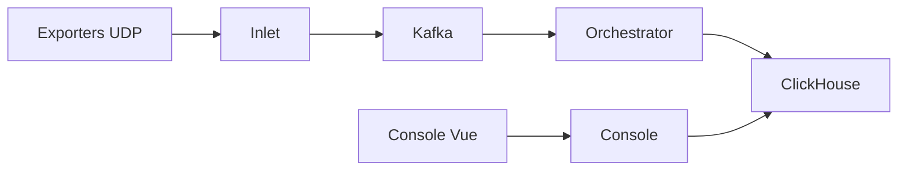

# akvorado/akvorado

> Network flow collector and visualizer for NetFlow, IPFIX and sFlow, for network teams.

## The problem
Understanding who consumes bandwidth on a network requires collecting, enriching and querying raw flows.

## What it is not
The provided README contains only the help section: it does not explain the product. What follows comes from the architecture, based on the code.

## What it actually does
The `inlet` service receives UDP flows, decodes them, enriches them (SNMP, GNMI, static, BMP/BGP, IPinfo or MaxMind geolocation) and publishes them to Kafka. The `orchestrator` consumes them and writes to ClickHouse. The `console` (Go backend, Vue front end) queries ClickHouse. A `demo-exporter` generates fake flows.

## How it is wired


## Trying it
```bash
akvorado version | head -2
```
Only command present in the README (version diagnostic). Installation: see the documentation embedded in the console.

## Cost and gotchas
Kafka + ClickHouse infrastructure to host. Geo enrichment via IPinfo.io possible (third-party service). AGPL-3.0 license.

## Alternatives
No alternative named in the README.

## For you
To watch: instructive and solid Kafka → ClickHouse pipeline, but network-specific; README too thin to decide further.
