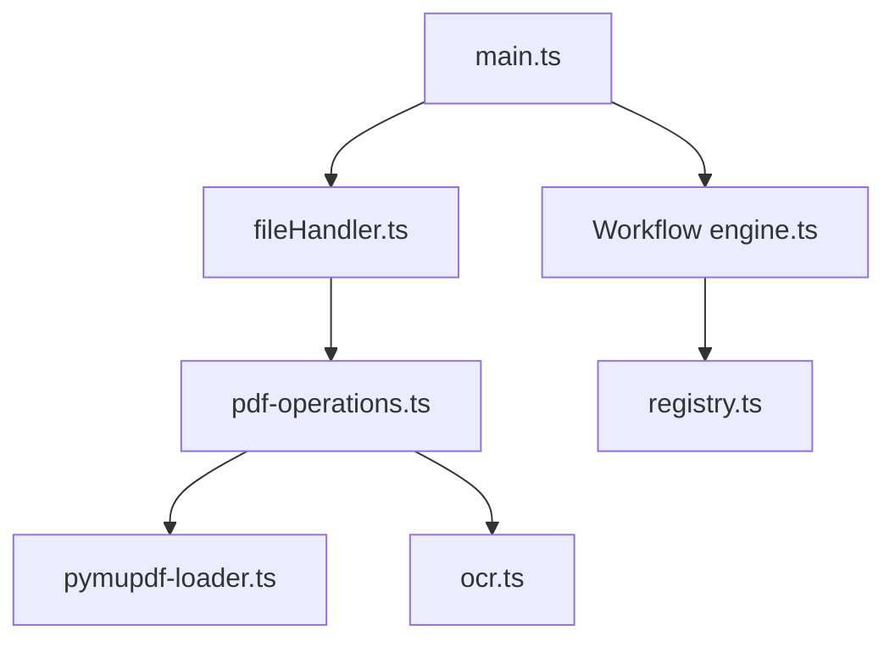

# alam00000/bentopdf

> A PDF toolbox that runs entirely in the browser, self-hostable, with more than 50 tools.

## The problem
Online PDF sites require you to upload your files, which is out of the question for sensitive documents.

## What it actually does
It merges, splits, edits, fills in forms, signs (X.509), redacts, compresses, runs OCR, and converts from and to Office formats, images and e-books.
All processing happens in the browser thanks to WASM modules: PyMuPDF, Ghostscript, CPDF, LibreOffice, Tesseract.
A visual editor lets you chain operations into a pipeline.
It can be hosted statically or in Docker, with a scripted air-gapped mode (`prepare-airgap.sh`).

## How it is wired


## Trying it
```bash
docker run -p 3000:8080 ghcr.io/alam00000/bentopdf-simple:latest
npm install
npm run build
npm run dev
bash scripts/prepare-airgap.sh
```

## Cost and gotchas
The license is AGPL-3.0, or a commercial license at $79 for closed-source use. By default, the WASM modules are loaded from jsDelivr; on an isolated network, you have to host them yourself.

## What it is not
It is not a PDF library for your Python scripts. Digital signing requires a CORS proxy (Cloudflare Worker).

## Alternatives
The README names no alternative repository. It mentions Kura and Hyper Compress, from the same publisher.

## For you
Worth watching: handy to install internally for the team's sensitive PDFs, but the AGPL and the default CDNs need to be validated with the IT department.
