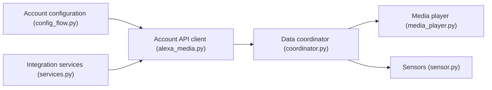

# alandtse/alexa_media_player

> Home Assistant integration to control Amazon Echo devices through the unofficial Alexa API.

## The problem
Make Echo devices show up as media players in Home Assistant.

## What it actually does
- Play/pause/stop, next/previous track, volume.
- Reports title, artist, album and cover art.
- The code also exposes sensors, switches, lights, alarms, notifications and diagnostics.
- Installation and configuration: deferred to the wiki.

## How it is wired

## Trying it
No command documented in the README: see the wiki.

## Cost and gotchas
An Amazon account is required. The README warns that Amazon may cut off access at any time, since the API is imitated from the Alexa app.

## What it is not
Not an official API nor a guaranteed service. Not an AI development tool.

## Alternatives
No alternative named in the README.

## For you
Ignore: home automation, unrelated to data/AI/MLOps, and dependent on an unsupported Amazon API.
