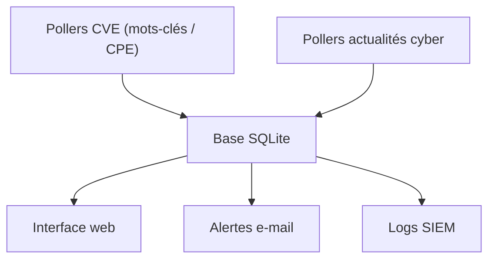

# alb-uss/SECMON

> Security monitoring web application: alerts on new CVEs affecting your fleet and cyber news.

## The problem
Tracking new vulnerabilities that concern the products in your fleet, and cyber news, requires manual monitoring.

## What it actually does
Queries CVEs by keywords or by CPE (exact version), sends e-mail alerts in English or French, displays at-risk products, exports an Excel report, checks whether exploits exist on GitHub or Exploit-DB and logs in a format that can be integrated into a SIEM (Splunk, Graylog). Multi-user web interface.

## How it is wired
Simplified diagram based on the sheet, no diagram provided.

## Trying it
The README points to the documentation for installation and gives no command. Prerequisites mentioned: Linux (tested on Debian 10), Python 3.8 or 3.9, a GitHub API key.

## Cost and gotchas
Free, but a GitHub API key is required. The GitHub key and the session key are neither encrypted nor hashed, and the SQLite database is in clear text: isolate the machine. Repository archived, last push in 2022.

## What it is not
Not a vulnerability scanner: it tracks published CVEs. The roadmap items (REST API, CPE scan) are not delivered.

## Alternatives
No alternative named in the README.

## For you
Ignore: archived since 2022, license to verify and secrets stored in clear text.
