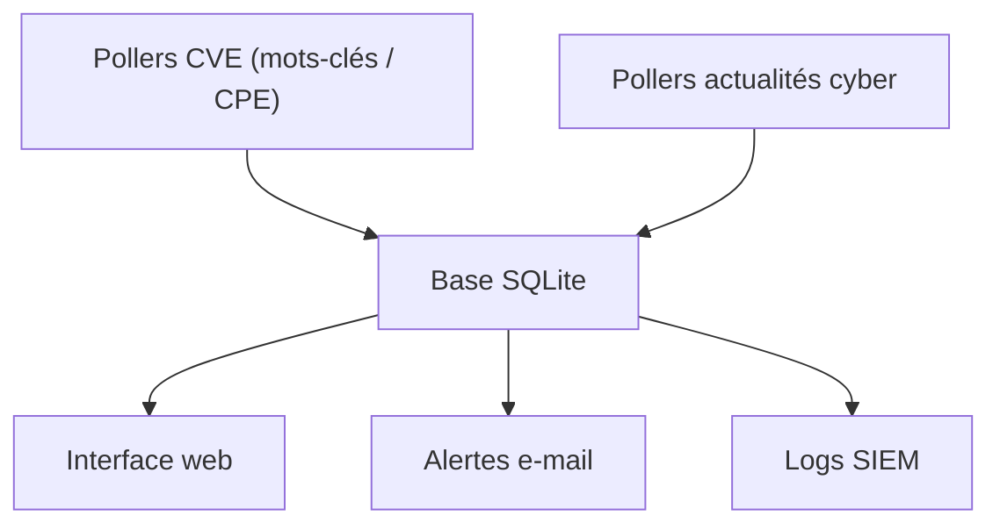

# alb-uss/SECMON

> Application web de veille sécurité : alertes sur les nouvelles CVE touchant ton parc et actualités cyber.

## Le problème
Suivre les nouvelles vulnérabilités qui concernent les produits de son parc et l'actualité cyber demande une veille manuelle.

## Ce que ça fait vraiment
Interroge les CVE par mots-clés ou par CPE (version précise), envoie des alertes par e-mail en anglais ou en français, affiche les produits à risque, exporte un rapport Excel, vérifie l'existence d'exploits sur GitHub ou Exploit-DB et journalise dans un format intégrable à un SIEM (Splunk, Graylog). Interface web multi-utilisateur.

## Comment c'est branché
Schéma simplifié d'après la fiche, sans diagramme fourni.

## Essayer
Le README renvoie à la documentation pour l'installation et ne donne aucune commande. Prérequis cités : Linux (testé sous Debian 10), Python 3.8 ou 3.9, une clé d'API GitHub.

## Coût et pièges
Gratuit, mais une clé d'API GitHub est requise. La clé GitHub et la clé de session ne sont ni chiffrées ni hachées, et la base SQLite est en clair : isoler la machine. Dépôt archivé, dernier push en 2022.

## Ce que ce n'est pas
Pas un scanner de vulnérabilités : il suit les CVE publiées. Les éléments de la feuille de route (API REST, scan CPE) ne sont pas livrés.

## Alternatives
Aucune alternative nommée dans le README.

## Pour toi
À ignorer : archivé depuis 2022, licence à vérifier et secrets stockés en clair.

