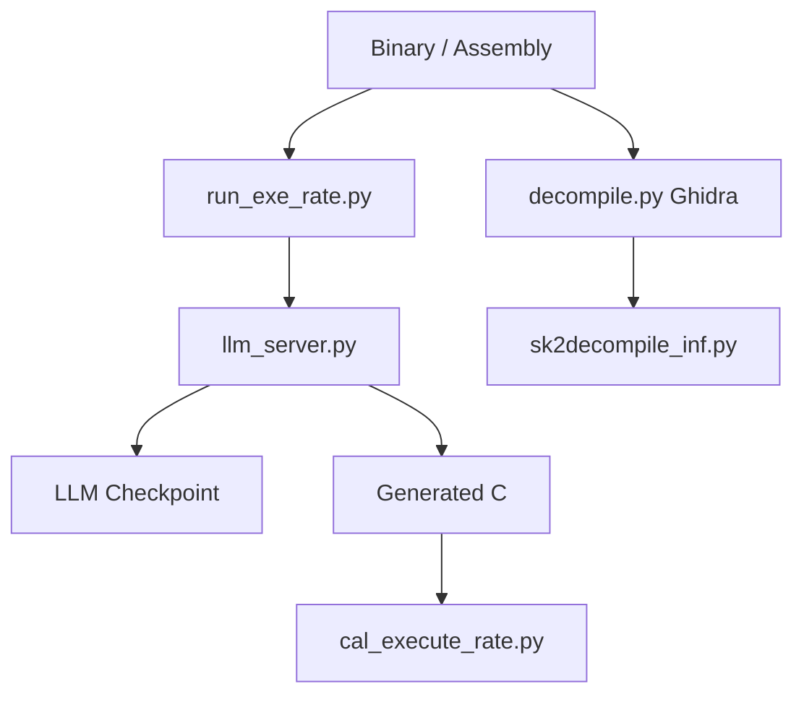

# albertan017/LLM4Decompile

> Open source language models that decompile Linux x86_64 binaries into C, for reverse-engineering researchers.

## The problem
A classic decompiler produces unreadable pseudo-code. Recovering readable, re-executable C from a binary is slow by hand.

## What it actually does
Takes assembly (extracted by objdump) and generates C. Two families: End (direct binary) and Ref (refines Ghidra pseudo-code). Models from 1.3 to 22 billion parameters on Hugging Face; the README reports 27.3% to 64.9% re-executability on HumanEval-Decompile. The code also includes evaluation, training and an SK²Decompile flow.

## How it is wired


## Trying it
```bash
git clone https://github.com/albertan017/LLM4Decompile.git
cd LLM4Decompile
conda create -n 'llm4decompile' python=3.9 -y
conda activate llm4decompile
pip install -r requirements.txt
docker build -t llm4decompile .
docker run --gpus all -it --name llm4decompile llm4decompile /bin/bash
```

## Cost and gotchas
GPU required (model loaded with `.cuda()`). Large weight downloads. Docker with `--gpus all` for the Ghidra demo.

## What it is not
Not a production tool: x86_64 Linux GCC O0 to O3 only. Only one decompiled function at a time in the example. The best score remains far from 100%.

## Alternatives
Ghidra, cited as the basis of the refined pseudo-code (v2); the README names no other competing repo.

## For you
Worth watching: relevant if you do security or LLM-and-code research, too specialized and unreliable for everyday data/MLOps use.
