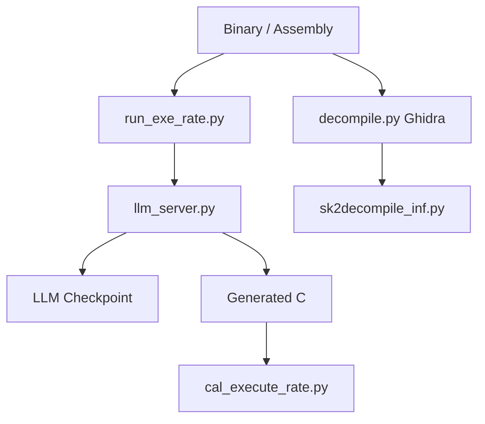

# albertan017/LLM4Decompile

> Modèles de langage open source qui décompilent du binaire Linux x86_64 en C, pour chercheurs en rétro-ingénierie.

## Le problème
Un décompilateur classique produit du pseudo-code illisible. Retrouver un C relisible et ré-exécutable à partir d'un binaire est long à la main.

## Ce que ça fait vraiment
Prend de l'assembleur (extrait par objdump) et génère du C. Deux familles : End (binaire direct) et Ref (affine le pseudo-code de Ghidra). Modèles de 1,3 à 22 milliards de paramètres sur Hugging Face ; le README donne de 27,3 % à 64,9 % de ré-exécutabilité sur HumanEval-Decompile. Le code contient aussi l'évaluation, l'entraînement et un flux SK²Decompile.

## Comment c'est branché


## Essayer
```bash
git clone https://github.com/albertan017/LLM4Decompile.git
cd LLM4Decompile
conda create -n 'llm4decompile' python=3.9 -y
conda activate llm4decompile
pip install -r requirements.txt
docker build -t llm4decompile .
docker run --gpus all -it --name llm4decompile llm4decompile /bin/bash
```

## Coût et pièges
GPU nécessaire (modèle chargé en `.cuda()`). Gros téléchargements de poids. Docker avec `--gpus all` pour la démo Ghidra.

## Ce que ce n'est pas
Pas un outil de production : x86_64 Linux GCC O0 à O3 seulement. Une seule fonction décompilée à la fois dans l'exemple. Le meilleur score reste loin de 100 %.

## Alternatives
Ghidra, cité comme base du pseudo-code raffiné (v2) ; le README ne nomme pas d'autre dépôt concurrent.

## Pour toi
À surveiller : pertinent si tu fais de la sécurité ou de la recherche sur LLM et code, trop spécialisé et peu fiable pour un usage data/MLOps courant.

